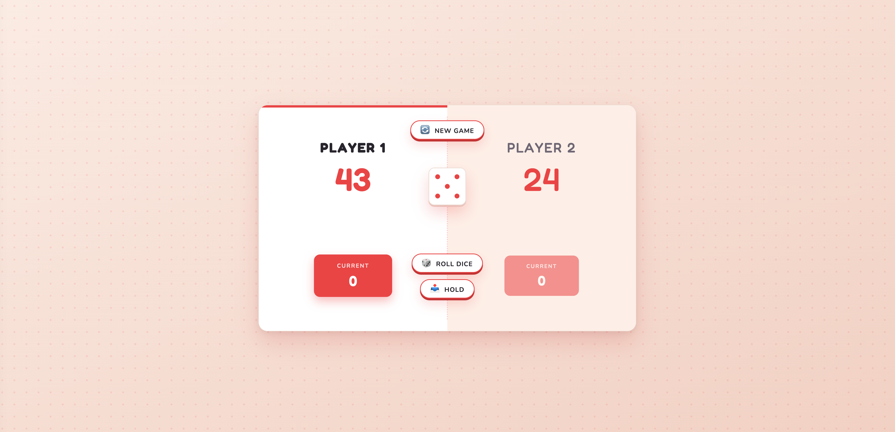
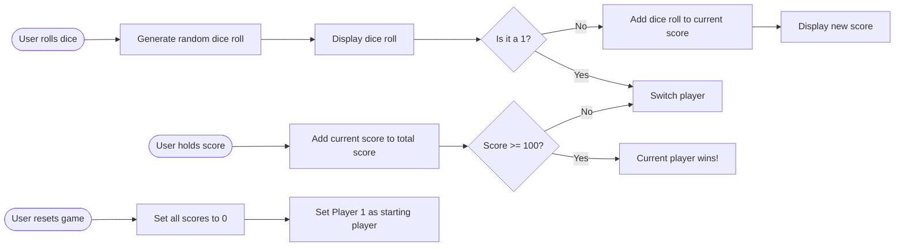

# 🎲 Pig Game

A simple two-player dice game built with **HTML, CSS, and vanilla JavaScript**.
Roll the dice, build up your points, and know when to hold. One unlucky **1** and you lose everything you gained that turn!



---

## 📖 Game Rules

1. The game is played by **2 players** who take turns.
2. On your turn, roll the dice as many times as you like:
   - Each roll is added to your **current score**.
   - If you roll a **1**, your current score is lost and the turn passes to the other player.
3. Press **Hold** to add your current score to your **total score**. The turn then passes to the other player.
4. The first player to reach **100 points** wins! 🏆
5. Press **New Game** at any time to reset everything.

---

## 🔄 Game Flow



---

## ✨ Features

- 🎲 Random dice rolls with matching dice images
- 👥 Two-player turn system with an active player highlight
- 📊 Separate **current** and **total** scores
- 🏆 Winner state when a player reaches 100
- 🔄 One-click game reset
- 🎨 Clean "tabletop" design with a dice-matched color palette

---

## 🛠️ Built With

- **HTML5**: page structure
- **CSS3**: styling, transitions, CSS variables
- **JavaScript (ES6)**: game logic and DOM manipulation

---

## 📁 Project Structure

```
pig-game/
├── index.html
├── style.css
├── script.js
├── dice-1.png
├── dice-2.png
├── dice-3.png
├── dice-4.png
├── dice-5.png
├── dice-6.png
└── README.md
```

---

## 🚀 Getting Started

1. **Clone the repository**

```bash
   git clone https://github.com/rahatulahsan/pig-game.git
```

2. **Open the folder**

```bash
   cd pig-game
```

3. **Run it** by opening `index.html` in your browser. No installs or build step needed.

---

## 🎨 Customization

All the main colors live as CSS variables at the top of `style.css`:

```css
:root {
  --red: #ec4e4e; /* matches the dice pips */
  --ink: #2e2a33; /* main text color */
  --paper: #fffaf6; /* game card background */
}
```

To change the winning score, update the target value (`100`) in `script.js`.

---

## 📚 What I Learned

- Selecting and manipulating DOM elements
- Handling click events
- Managing game state (scores, active player, playing/finished)
- Toggling CSS classes to update the UI
- Planning logic with a flowchart before coding

---

## 📄 License

This project is open source and available under the [MIT License](LICENSE).

---

⭐ If you enjoyed this project, consider giving it a star!
